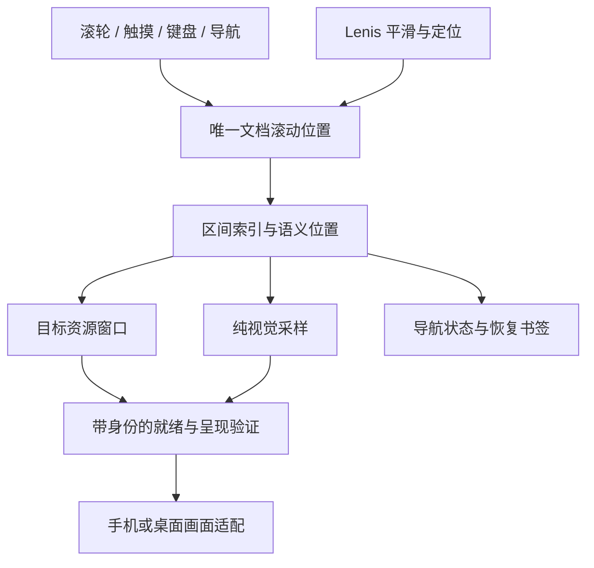

# 连续滚动驱动的双端故事时间轴

## 1. 目标、授权与旧方案的关系

直接需求来源：用户澄清“逐帧”的含义是滚动速度控制动画推进速度、快速滚动、随时定位、Lenis 式丝滑跟手，**不是触发一次后自动完整播放**；随后要求开始重新梳理方案。

用户已以“你做吧”确认本方案，现进入实施。授权包含本方案内的代码、必要依赖、排错与验证；不包含 agent、分支/worktree、提交或发布。工作区已有阅读平滑、手机恢复修复及测试改动，必须保留并按新架构逐项迁移，不整体覆盖或回退。

2026-10-15 补充授权：用户要求继续迭代、commit/push，并明确确认将已有迭代与本轮验收修复直接提交推送到 `origin/main`；不部署网站。只批准清理三个指定旧版本的本地 CDN 副本，不授权清理其他数据。该补充不扩大架构、数值预算或 agent／分支／发布权限。

### 2026-10-11 手机触摸策略补充（已确认）

用户在明确手机原先 `syncTouch: false`、启用 Lenis 可统一拖动和松手惯性但不能保证桌面等同手感后，以“那你做一下呢”批准接管手机触摸。本补充取代下文的**初始**原生触摸策略；不是声称已有真机验收，也不改变视频解码与视觉采样架构。

- 目标：手机单指拖动由 Lenis 同步，松手使用其惯性，重新触碰刹停、反向立即响应；桌面滚轮策略不变。
- 模块和接口：`createStoryScrollSource(onFrame, { syncTouch?: boolean })` 默认关闭；共享 `StoryScrollShell` 仅在 `platform === 'phone'` 时开启。保留唯一 RAF 和文档滚动轴，不增加手势积分器或第二层进度追赶。
- 参数：`touchMultiplier: 1`、`syncTouchLerp: .075`、`touchInertiaExponent: 1.7`，采用当前锁定 Lenis 1.3.26 的标准触摸曲线，桌面 `lerp: .18` 不变。
- 原生边界：多指、已缩放视口、文本选择整次手势交还浏览器；可编辑控件、打开的菜单内部滚动不接管；`touchcancel` 清除余量。减少动态效果时关闭触摸与滚轮平滑；导航、隐藏和恢复沿用现有取消惯性接口。
- 验收：单元测试验证接线、单帧循环、原生边界与清理；浏览器触摸注入验证跟手位移、松手继续、触碰停止、反向、取消及恢复、菜单落点和减少动态效果，并回归桌面滚轮／键盘、历史与旋转。真实 iPhone／Android 手感、旧版 iOS 兼容性和解码卡顿必须另行实测，不以模拟设备通过替代。

旧文档 `docs/plans/2026-10-10-smooth-scroll-dual-platform-design.md` 明确保留“一次手势触发一段”，与澄清后的目标不符。本方案建议取代其中的输入、时间轴、交接与导航模型；旧方案中的内容保真、资源上限、无障碍、手机恢复与验证诚实性继续有效。旧实现及验证记录保留为历史证据，不能作为新体验已完成的证明。

### 需求追踪

| 编号 | 必须实现的体验 | 可观察结果 |
| --- | --- | --- |
| R1 | 滚动位置决定叙事画面 | 相同位置与布局得到相同构图；不是靠进入过哪些段落决定画面 |
| R2 | 快慢、暂停、反向均跟手 | 平滑位置停止后叙事不再自行播放；反向从当前画面退回，不先播完 |
| R3 | 快速穿越、任意定位 | 可一次跨多个段落；只准备最新目的地，不排队播放中间章节 |
| R4 | 保留完整视觉与内容 | 16 场景、15 转场全部覆盖；透明视频、拱门、墨迹、纸面、构图与正文不删减 |
| R5 | 正文与动画属于同一滚动轴 | 读到底继续同一次滚动即可进入动画；不需要松手再滑或解除锁定 |
| R6 | 双端导航、恢复、无障碍正确 | 菜单、原有 hash/别名、后退、锁屏、旋转、缩放和减少动态效果均可用 |
| R7 | 资源受控、错误可恢复 | 有界解码与预热；资源未到时可继续改变目标；不白屏、不显示错误章节已就绪 |
| R8 | 可验证的流畅度 | 同时记录滚动、目标进度、实际呈现帧；真机不以模拟、镜像或单独 RAF 数字替代 |

不新增视觉风格、内容或导航入口。不改变线上版本，不把发布授权包含在架构批准中。分阶段只是执行顺序，最终交付必须覆盖全部双端链路。

## 2. 已核对的代码与资料

### 本地事实

- `app/package.json`：React 19、GSAP 3.13、XState 5；当前 React 应用无 Lenis 依赖。
- `app/src/story/canonical-spine.ts`：16 个正式场景、15 条相邻转场，同时定义 reading/freshInput 等旧行为。ID 和顺序保留，freshInput 不再作为正常滚动门槛。
- `app/src/production/phone-story/runtime.ts` 的 `syncPlayback`：根据开始时间及 duration 计算进度；阶段完成再发完成事件。这是手机自动播放源头之一。
- `app/src/pilot/progress-timeline.ts`：既有 `progress(value)` 直接采样能力，也有 `play/reverse` 内部时钟。新路径复用前者，不调用后者推进故事。
- `app/src/production/phone-story/manifest.ts`：已有进度曲线、透明度、前景所有权及视频时钟所有权；可提取视觉采样，但不能照搬依赖 direction/stage 的事务身份。
- `app/src/media/timeline-video-driver.ts`：已有暂停 seek、按源帧量化、在途与最新请求合并、异步身份以及呈现证据。不能据此声称现有手机所有视频已随滚动定位；手机 leaf 的 phase/endpoint 控制仍需改造。
- `app/src/production/desktop/DesktopStoryShell.tsx` 与 `app/src/production/phone-story/PhoneStoryShell.tsx`：双端有各自编排。保留平台显示差异，但不再保留两套叙事进度决策。
- `app/scripts/verify-phone-clean-architecture.mjs`：现有手机核心严格限制为 10 文件、指定导入边界、核心 5,775 行预算；新共享控制模块必须显式纳入检查，不能移出目录规避统计。
- `app/scripts/verify-performance-budgets.mjs`：手机 JS 665,600 bytes、桌面 JS 581,632 bytes 且需 4,096 bytes 余量、初始 CSS 76,800 bytes；其余现有预算也继续生效。
- 前轮记录 `docs/plans/2026-10-10-smooth-scroll-validation.md`：手机包仅余 67 bytes。因此不能把 Lenis 和新运行时直接叠在旧系统上；须替换并退役旧控制代码后按实际产物验收。

仓库无 `docs/brainstorms/`、`docs/solutions/` 可用来源。研究限于本项目、用户澄清和以下公开一手资料，未读取其他项目或私人资料。

### 外部依据及其影响

- [Lenis 官方 README](https://github.com/darkroomengineering/lenis)：支持与原生文档滚动结合、统一帧循环及滚动更新；触摸同步有兼容性注意事项。采用真实 Lenis，初始移动端策略保留原生触摸惯性，不叠加另一层触摸插值。具体版本在实施时锁定并验证，不凭主分支文档假定本地已有。
- [GSAP ScrollTrigger](https://gsap.com/docs/v3/Plugins/ScrollTrigger/)：直接 scrub 与数值追赶不同。新模型只保留一层滚动平滑；不再附加有延迟的 scrub、自动 snap 或进入触发播放。项目已有复杂画面采样器，优先直接向其传进度，不为使用插件而建立第二套主时间轴。
- [HTMLMediaElement.currentTime](https://developer.mozilla.org/en-US/docs/Web/API/HTMLMediaElement/currentTime)：赋值可请求定位；它本身不是画面已呈现的证据。
- [requestVideoFrameCallback](https://developer.mozilla.org/en-US/docs/Web/API/HTMLVideoElement/requestVideoFrameCallback)：可观察视频帧提交及媒体时间，但不保证每次回调都与实际屏幕刷新严格同步。因此分别测滚动调度、视频帧跟随和真实屏幕表现。

## 3. 核心架构决定（已确认）

| 决定 | 原因与边界 |
| --- | --- |
| 一个真实文档滚动轴，Lenis 只负责平滑输入/定位 | 滚动条、触摸惯性、键盘、焦点与历史有真实坐标；不使用全页 transform 冒充滚动 |
| 一份共享位置解析器，双端各自画面适配 | 相同叙事规则、不同布局和媒体；避免手机仍按段播、桌面才支持跟手 |
| 所有正常叙事由绝对位置采样 | 进入回调、播放完成回调不再是必经路径；快滚跳过任意多个边界也能正确显示 |
| 保留视觉曲线，废除强制播放/停顿时钟 | 原镜头比例可映射为滚动距离；不强迫观看固定秒数，不要求 fresh gesture 才继续 |
| 资源准备与滚动意图分离 | 可暂停呈现未就绪画面，但不能冻结滚动轴；最新目的地始终覆盖旧请求 |
| 保留画面证明，改为当前位置证明 | 不再只证明“章节开头/终点”；必须证明目标区间、进度、布局和资源代次匹配 |
| 默认无自动吸附，无第二层进度惯性 | 用户可停在任意中间位置；动画不在 Lenis 已停后又自行追赶一段 |

### 3.1 单一位置的数据流

以下是架构方向示意，不是实现代码。

- `targetScroll` 是输入目的地，`scroll/animatedScroll` 是当前实际采用的平滑位置；叙事采样只读后者。原生触摸路径读同一文档位置，不自行再积分 delta。
- 一个帧调度源依次更新滚动、解析位置、提交 DOM/Canvas/视频目标。不能同时启用 Lenis autoRaf、独立 GSAP ticker 和旧播放 RAF。
- 视频解码回调只报告帧就绪，不推进全站位置。React 仅处理窗口结构、错误、导航等变化，不逐帧重渲染整个壳。
- 方向用于预热和诊断，不决定同一位置应出现哪幅画面；反向不会切换另一条不相等的叙事路径。

### 3.2 滚动几何与正文

全轴由明确的静态停留区、正文区、转场区组成，区间首尾连续，无 dead zone。阅读距离来自实际排版，不套固定一屏上限。每个区间都有稳定 ID 和像素 start/end；相同场景在两端可有不同阅读高度，但语义顺序一致。

- 正文保留一个可访问、可选择、可聚焦的文档副本；不在阅读副本和视觉副本间反复切换滚动所有者。不为每一帧写正文内部 `scrollTop`。
- 动画段有自己的滚动长度，视觉容器 sticky/fixed，内容按局部进度采样。长度包含 pin 占位，正文起点必须与动画终点在同一文档几何中对齐，不能出现隐藏的第二份占位。
- 所有正文布局骨架常驻；可延迟加载媒体，但正文测量不依赖先播放前面的章节。未下载字体/图片用明确尺寸约束；字体到达后批量重测并按语义锚点补偿位置，不能改变当前正在阅读的句子。
- 同一个正文根参与前后转场，容器固定/自然流姿态从区间坐标确定；拱门等共享前景单独持有，不能通过复制整段正文拼接。
- 布局以稳定视口高度作为动画距离基准；手机地址栏高度变化更新裁切，不重算整条滚动轴。真正的宽度/方向/字体变化才重建区间。
- 短内容也保持原构图的最小展示区域，不自动滑走。正文块的顶部、底部和过渡接缝共同决定距离，不能把每个 hold 都机械增加一屏空白。

动画局部进度为当前位置在该区间中的比例。初始动画距离建议按原创作时长的相对权重分配，再统一调校；原毫秒值不再表示真实强制播放时长。下表给出可逆的首轮调校初值，单位为稳定视口高度 H，不是已验证参数。

| 转场 | 初值 | 必须保留并改为可定位的关系 |
| --- | ---: | --- |
| hero-pattern | 2.5H | 人物/镜头运动，然后墨迹显露；分段比例保留 |
| pattern-star-map | 3H | Pattern 收拢、星图显露，不依赖播放过 Pattern |
| star-map-aod | 1H | 墨迹与 AOD 初帧覆盖 |
| aod-method-top | 2H | AOD 运动及 Method 文字接入 |
| method-bottom-figure2 | 1H | 正文末尾接 Figure2 初帧和拱门 |
| figure2-distance-expand | 3H | 人物运动、纵深墨迹与 Proof；旧延时停顿改为有限距离的静态区间 |
| figure2-proof-brand | 1H | Proof 全部阅读后再衔接 Brand；前景拱门生命周期正确 |
| brand-figure3 | 1H | Brand 接 Figure3 纸面/初始合成 |
| figure3-services | 2.5H | 视频/纸面与 Services 后段显露共享同一进度 |
| services-ttg | 1H | Services 正文接 TTG 初帧 |
| ttg-lab | 2.5H | 视频后接 Lab；播放与淡化的比例保留，不需再次手势 |
| lab-ph | 1H | Lab 接 PH 初帧及原墨迹方向 |
| ph-education | 2H | PH 运动与 Education 阅读交接 |
| education-crane | 1H | Education 接人物、鹤群初帧 |
| crane-contact | 3H | 双视频、墨迹、Contact；删除仅为旧解码等待增加的时间尾巴 |

16 场景和所有原正文均在轴上，包括手机 Brand/Contact 的原生阅读内容。Proof 的 opening/cards/closing 仍为可导航阅读子锚点，而不是重新添加两条强制播放段。

### 3.3 关键接口责任

这些是语义契约，不预写具体语言签名。

| 模块 | 输入 → 输出 / 所有权 |
| --- | --- |
| 滚动源 | 输入、导航目的地 → 当前位置/目的位置/方向；唯一正常滚动控制者，暂停和销毁可清理 |
| 区间索引 | 平台、布局测量、叙事清单 → 连续区间；提供绝对位置解析和语义锚点反查 |
| 位置快照 | layoutRevision、rangeId、局部 progress、阅读 anchor/offset、requestRevision；目标更新可 supersede，不排播放队列 |
| 画面采样 | 区间、局部进度、布局 → 场景局部进度、遮罩、层级、透明度、视频目标时间；无等待、无副作用时钟 |
| 资源窗口 | 最新快照 → 所需源/效果/目标依赖；请求 generation、取消、预热及有界释放 |
| 呈现适配 | 画面采样 + 已准备资源 → DOM/Canvas 更新和帧证据；无权推进全站位置 |
| 恢复/导航 | 语义位置 ↔ 新布局像素位置；显式导航优先，旧恢复不得覆盖新导航 |

正常连续采样不为每个滚动像素创建完整 load transaction。requestRevision 可每目标样本增长，资源 generation 仅在资源集合、生命周期或失效变化时增长；否则高频滚动会反复取消自己的下载/解码。另以 intentEpoch 标识跨区间、显式导航、改向和恢复等会使旧呈现失效的意图变化，改向不要求更换资源 generation。

### 3.4 资源未就绪、跨段和错误

- 分开记录 desiredPose 与 presentedPose。跨三章快滚后直接解析最终区间并准备其必要源/效果/目标，不要求经过中间 stable commit。
- 尚未就绪时展示**属于目标区间**的已验证 poster/背景及加载状态；没有合格目标底图则使用已有 Loading 的安全底色与状态。不得长时间显示上一章却标记已到目标章。
- 普通解码追赶可保留该区间上一张合格帧；不能把不同区间旧帧当作当前帧。就绪后呈现最新目标，不回放欠下的帧。
- poster、安全覆盖和简化正文是加载/失败状态，不算完整 scrub 验收通过。正常已加载的动画仍必须支持任意中间帧。
- 用户在准备期间继续滚、反向、点菜单或按返回键都有效。异步结果校验资源代次、区间、intentEpoch、layoutRevision 和已呈现序号，不能覆盖更新的画面。同一有效意图内允许提交有界滞后的已解码帧，同时继续 seek 最新目标；不能要求每张帧恰好等于不断变化的最新 requestRevision，导致所有帧被拒绝而永久冻结。停滚后必须收敛到最终目标。
- 必要依赖最高优先；邻近方向预热可取消，有字节和解码数量上限。目标依赖沿用对应 manifest closure 的数值预算，预热占用也计入同一当前窗口；预算不足时取消预热、释放旧窗口，不同时保留两个完整重型 closure。快滚不能让一路经过的 16 个场景同时常驻解码器。
- 既有 prepared/final evidence 的身份与资源约束保留；“终点完成”不再控制是否允许输入。媒体超时明确显示重试/直接阅读；直接阅读不伪装成动画成功。

### 3.5 视频与可逆视觉

- 视频始终由局部进度映射到源时间；不通过 playbackRate 模拟滚动速度，也不依赖负播放速率倒放。叙事视频保持暂停，向既有 seek driver 提交最新目标。
- 保留一条在途 seek 和最新待处理目标，按素材真实帧率量化。相同资源内改变方向不重建解码器，也不把方向变更当作必须回到端点的新 run。
- 源帧到达、Canvas/WebGL 合成及遮罩必须对应同一目标版本；Crane 人物与鹤群的组合需要同一 pose 的双表面证据，不能一层新一层旧。
- 审计所有 leaf 的 render、settle、activate、setMediaPhase：移除 render 中依赖“以前走过的阶段”的状态，激活仅解决媒体权限/准备，不启动叙事自动播放。
- 原正反向若存在不同构图/所有权切换，以同一正向创作进度函数的递增/递减为新规范；保留前景、透明与构图，但重做依赖历史方向的跳变。这是控制模型变更的一部分。
- Hero、AOD、Figure2、Figure3、TTG、PH、Crane 人物/鹤群全部纳入，不只验证两三个容易 seek 的视频。Loading 可按加载状态工作；任何开场叙事自动片段不得阻止用户滚到指定位置。
- 素材先用现有短 GOP、packed alpha 与原解码链路验证。若性能不达标，按现有可复现脚本生成针对性派生素材，保留画质、透明度、帧数及资源预算。全量图片序列不是默认兜底；无法在现有约束内达标时报告具体阻塞，不擅自降低目标或扩大预算。

### 3.6 双端、导航与恢复

- 桌面：Lenis 平滑滚轮/触控板，正常文档键盘与拖动滚动条也更新同一时间轴。移除旧输入 charge、每手势章数限制、reading handoff 和第二个阅读追赶器的生产接线。
- 手机：同一滚动源接入 Lenis，但初始 `syncTouch` 关闭，保留原生触摸惯性；动画逐帧读取真实文档位置。不是“手机只优化正文”，其全部叙事同样连续 scrub。是否需开启触摸模拟由实机同步指标判断，不能不经验证默认开启。
- 菜单与既有 hash 定位到语义章节/Proof 子锚点。显式菜单直接抵达目标，取消原惯性，不强制快速播放整站。普通滚动只更新当前位置记录，不逐帧 push 历史。
- 历史状态保存语义区间和局部位置；支持 back/forward、刷新、BFCache。原 hash 兼容，不新建公开 URL 格式。菜单改变焦点，连续滚动不抢焦点。
- 现有正式入口及 `/brand-lab` 保持各自路由语义；局部入口复用同一位置与呈现契约，不意外拓展其内容范围。桌面旧 harness 的兼容导出不等于正式入口可以继续使用旧自动播放器。
- 锁屏/隐藏保存当前可见语义位置、取消平滑余量与媒体工作；回前台重测并证明同一位置，不把隐藏时长当作应补播进度。旋转在正文优先保留同一文字块及相对偏移，在动画保留同一区间进度。
- 地址栏、缩放、多指、文字选择、链接、输入控件、菜单自身滚动都保留平台原生语义；不全局阻止触摸。
- reduced-motion 使用可连续阅读和导航的静态构图/必要的即时切换，移除长动画占位及平滑追赶；动态切换按语义位置重映射，不能跳错章。no-JS 正文和 SEO 不退化。

## 4. 实施单元与依赖

执行默认主线程，无 agent、无新分支/worktree。先建立会揭露旧模式问题的契约测试，再替换控制器。单元顺序 U1 → U2 → U3 → U4 → U5 → U6；内部可复用已测模块，但不把局部演示作为最终完成。

- [x] **U1：连续位置与画面契约**

需求：R1–R5。依赖：本方案确认。

文件：新增 `app/src/story/scroll-spine.ts`、`app/src/story/scroll-spine.test.ts`；调整 `app/src/story/canonical-spine.ts`、`app/src/story/manifest.ts`、`app/src/production/phone-story/manifest.ts`；新增 `app/src/story/scroll-pose.test.ts`，扩展 `app/src/production/phone-story/choreography.test.ts`、`app/src/transitions/endpoint-continuity.test.ts`。

做法：以现有 canonical IDs 建立完整区间清单和纯采样契约，先固定边界、子阶段比例与语义锚点；剥离 freshInput、自动停顿、direction 依赖，不改内容。所有旧 holds 显式映射为阅读/静态/动画边界，避免零长度或漏掉场景。

测试：每个转场的 0/25/50/75/100%；相同坐标正向进入、反向进入、冷定位所得 pose 相同；边界 ±epsilon 连续；一帧跨越 5 个区间仍直接解析目的地；Proof 三锚点、零滚动高度、超出首尾、无效数值；完整 16/15 覆盖。验收：解析与采样不读取时钟、DOM 或过往事件顺序。

- [ ] **U2：真实文档布局与单一 Lenis 接线**

需求：R1、R2、R5、R6。依赖：U1。

文件：新增 `app/src/production/story-scroll-source.ts`、`app/src/production/story-scroll-layout.ts` 及各自 `.test.ts`；修改 `app/package.json`、`pnpm-lock.yaml`、双端 Shell、`app/src/production/phone-story/styles.css`、`app/src/production/editorial-layout.css`、`app/src/stage/reading.ts`；测试 `app/src/production/phone-story/PhoneStoryShell.test.tsx`、`app/src/styles.fixed-background.test.ts`、新增 `app/src/production/story-scroll-layout.test.tsx`。

做法：引入锁定版本的 Lenis；搭建全部正文与动画占位，保留轻量内容模块、延迟媒体。统一调度、滚动条与焦点，去掉正常叙事中的页面滚动锁。只允许菜单模态等明确覆盖层临时锁定且可清理。

测试：一条长手势从 Method 正文进入 Figure2 中间；向前/向后滚动跨接缝无二次手势；触摸、滚动条、PageDown/Home/End、焦点定位同轴；字体加载和视口变化保留文字锚点；卸载/StrictMode 不重复监听与 RAF；单一正文可访问、没有重复 ID。验收：只存在一个文档滚动所有者，无嵌套正文抢滚动。

- [ ] **U3：可随机定位的资源与呈现协调**

需求：R1、R3、R7。依赖：U1、U2。

文件：新增 `app/src/runtime/scroll-story-runtime.ts`、`app/src/runtime/scroll-story-runtime.test.ts`；修改 `app/src/production/phone-story/protocol.ts`、`machine.ts`、`runtime.ts`、`presentation.ts` 和对应测试；修改 `app/src/runtime/director.actor.ts`、`director.machine.ts` 及其测试，使旧自动播放控制器退出正式入口；调整双端 Shell、module-loaders、`app/src/production/adjacent-prewarm.ts` 与测试。

做法：共享纯位置/意图协调器，平台适配保留资源登记、呈现证明、视图与生命周期差异。旧 machine 的可复用状态转为资源状态而非故事推进权威；不能新旧运行时同时接管同一页面。窗口优先目标，当前已呈现画面保留到替代可显示或明确安全覆盖。

测试：Hero → Education 任意进度无需播放中间段；跳转过程中连续改三次目标只呈现最新；反向、取消、失败再导航无旧结果覆盖；准备中滚动坐标继续变化；高频同资源采样不重启加载；窗口资源有界；销毁后所有旧回调失效；读到 Services 再锁屏不会使全页 inert。验收：无等待动画完成才能输入的状态；失败路径仍可使用导航/正文。

- [ ] **U4：全部动画与视频接入绝对进度**

需求：R1–R4、R7、R8。依赖：U1、U3。

文件：修改 `app/src/pilot/progress-timeline.ts` 及测试；`app/src/media/timeline-video-driver.ts` 及测试；`app/src/media/phone-packed-alpha-surface.ts` 及测试；16 场景在 `app/src/scenes/` 的 index/phone 实现与测试；15 转场在 `app/src/transitions/` 的 index/phone 实现与测试。重点 `app/src/scenes/figure3-animation/phone/PhoneFigure3.tsx`、`app/src/scenes/ttg-animation/phone/PhoneTtg.tsx`、`app/src/stage/PhoneRetainedFigure2Arch.tsx`。新增 `app/src/media/scroll-media-coherence.test.ts`；扩展 `app/src/transitions/figure2-proof-chain.test.ts`、`group4-transitions.test.ts`、`group5-transitions.test.ts`、`group7-transitions.test.ts`。

做法：逐项对照第 3.2 节全部转场表，移除自动时钟和端点重置，保留纯采样与合成实现。视频驱动复用最新目标机制，冷启动支持任意中间帧；媒体激活不授予播放推进权。

测试：全部素材 10/50/90% 暂停与回退；0.8 → 0.2 → 0.65 异步 seek 不接受旧意图倒灌并最终抵达 0.65；持续输入速度高于解码速度时仍有有效帧提交，不发生最新请求饥饿；改向不回首帧；Crane 两视频对齐；拱门中点与 Proof 边界同位返回无闪烁；慢解码、WebGL 丢失、loadedmetadata 修正 duration；初次直接定位中间态与从首段滚入截图一致。验收：原视觉仍完整，任意中间态可保持，不可用 poster 代替已就绪动态中间帧。

- [ ] **U5：导航、历史、恢复、无障碍及控制器退役**

需求：R3、R5、R6。依赖：U2–U4。

文件：修改 `app/src/production/navigation.ts`、`StoryNav.tsx`、`proof-alias-navigation.ts` 与对应测试；双端 Shell 与测试；`app/src/production/phone-story/reading-bookmark.test.ts`；新增 `app/src/production/story-scroll-restoration.test.ts`；迁移/退役 `input-controller.ts`、`reading-smooth-motion.ts`、`reading-handoff.ts`、`reading-edge-latch.ts`、`gesture-intent-gate.ts` 的正式故事接线及相关测试，按实际剩余用途保留而不盲删。

做法：语义位置统一处理所有定位源，原 hash/别名兼容，稳定恢复可被新导航取消。前轮锁屏、书签与 WebKit 根滚动修复作为回归需求迁移，不照搬旧 DOM 所有权机制。

测试：菜单 Services → Education → Method → Education 每次可滚；滚动/视频中间态锁屏再恢复；正文旋转不回顶部；BFCache/back/forward/冷 hash/Proof aliases 与 `/brand-lab`；菜单打开关闭无残留锁；reduce 动态开关不跳章；链接/焦点/选择/缩放可用。验收：新路径不导入或调用旧分段自动播放器，无死代码为叠加包体兜底。

- [ ] **U6：治理检查、全链路与真实设备验收**

需求：全部。依赖：U1–U5。

文件：更新 `app/scripts/verify-phone-clean-architecture.mjs` 及 `.test.mjs`、`verify-homepage-module-boundaries.mjs` 及测试，使新导入图纳入治理；保留 `verify-performance-budgets.mjs` 的数值门槛；新增 `app/e2e/r5-scroll-scrub.spec.ts`、`app/scripts/verify-scroll-scrub.mjs`；更新 `app/e2e/r5-production.spec.ts`、`r5-phone-clean-presentation.spec.ts`、`r5-phone-clean-assertions.ts`；新增 `docs/plans/2026-10-10-continuous-scroll-validation.md`。

做法：旧测试中“必须等播完/新手势才能过段”等断言由新契约替换，视觉、身份、媒体、资源和恢复断言保留。架构检查允许明确的新共享模块，但仍禁止手机拉入桌面壳与第二时钟；纳入共享核心后总行数预算不变，不通过移目录规避。所有产物按包含 Lenis 的实际依赖闭包计入原预算。

测试：第 5 节完整矩阵；同一构建跑静态检查、全量单测、媒体/包体/模块门槛、双引擎功能及真机。验收：每个必需项有结果与证据；没有真机或性能未达标即明确未完成相应验收。

## 5. 验收标准（已确认，结果另记）

### 功能硬门槛

1. 所有 15 转场双向可停在 25/50/75%，平滑滚动完全停止后保持 2 秒，叙事 pose 不变；播放时间不自行走到端点。原有环境装饰若独立运动须单独列出，不能改变叙事 pose。
2. 连续手势可跨正文和多段动画；大位移跨至少 3 章，不需要逐段自动播放或重新输入。滚动幅度与位置对应，无每手势一屏/一段限额。
3. 同一坐标从正向、反向、直接定位进入，关键图层/透明度/裁切/视频帧相同；前景接缝不得闪白或露出黑底。
4. 菜单跳转、滚动条跳跃、End/Home、浏览器历史、章节 hash 和 Proof 子锚点全部走同一位置解析；没有旧惯性回拉。
5. 慢资源、失败、快速改目标和卸载都不得锁死滚动，旧请求不得覆盖新画面。临时加载/失败覆盖必须显式记录，不能列为视频就绪。
6. 全部 16 章从 Hero 到 Contact 再返回，重复两轮；资源在窗口收敛后回落到相应上限，无增长趋势和残留帧循环。
7. 复现路径“场景卡住 → 留学仍不能滚 → 方法 → 留学恢复”不再成立；每一处都可独立滚动，且真机锁屏回来不失效。

### 跟手与性能测量

以下为已确认目标，不是已有性能结论。为避免只看调度 FPS，记录输入/文档位置、局部目标进度、实际视频媒体时间、Canvas 提交、帧回调间隔与资源数，并标注设备、电源模式、浏览器、素材帧率和缓存条件。

| 情况 | 目标 / 判断方式 |
| --- | --- |
| 已准备 DOM/Canvas 动画 | 每次有效位置更新在下一可用渲染帧采样；不增加第二层时间追赶 |
| 60Hz 前台稳定滚动 10 秒 | RAF 帧间隔 P95 ≤ 20ms；无本次引入的 >50ms 主线程长任务；不可把 RAF 当成视频实际呈现 FPS |
| 已准备视频普通连续滚动 | 可观察的呈现相对最新目标滞后 P95 ≤ 100ms，记录源帧粒度；快速跨段另计准备，不用普通指标掩盖加载 |
| 平滑位置停止后的媒体收敛 | 在热资源下 150ms 内到达目标源帧，误差不超过 1 个源帧；端点继续沿用精确证据，不能放宽已有证明窗口 |
| 反向 | 不先完成旧方向剩余段；下一次采样目标即下降，媒体沿最新目标收敛 |
| 冷定位/弱网 | 单独记录下载、解码和可呈现时间；不承诺零延迟，但始终可改目标、可解释等待、可恢复 |
| 120Hz / 省电 | 实测记录可达到的刷新率与帧预算，不用库宣传保证 120Hz；若平台限制未达目标，按实际说明 |

桌面覆盖滚轮与触控板、1440×900；引擎覆盖 Chromium/WebKit 和 360×800、390×844、430×932、横屏。真实设备至少 iPhone Safari 与 Android Chrome，重点长快滑、按住停、反向、边界、地址栏、锁屏、旋转、触摸点选。用户的 iPhone Air 仍是待实测设备，镜像观感不作 FPS 证据。

## 6. 迁移风险与未决事项

| 风险 | 处理与不得越过的边界 |
| --- | --- |
| 任意视频 seek 性能不够 | U4 必须取帧级证据，优先复用并优化现有短 GOP 路径；达不到就报告，不改回自动播放或静态假动画 |
| 旧前后向构图有路径依赖 | 统一绝对 pose，逐段截图与边界测试；以原正向画面为视觉基线，保留元素和合成关系 |
| 页面总高度随延迟内容变化 | 轻量正文与尺寸骨架先布局，字体/图片重测以语义书签补偿；不允许一路滚动一路重排所有前文 |
| 手机异步原生滚动与固定 Canvas 不同步 | 真机测量而不是推断；先原生触摸接线，若不能达到跟手标准再比较受控同步触摸方案，不静默把移动端排除 |
| 几乎没有新增包体空间 | 替换旧控制路径、精简重复协议，维持所有数值门槛；无法满足时停止相关交付并提交事实，不自行提高限制 |
| 旧严格式治理检查拒绝新图 | 本方案明确请求确认“可更新模块拓扑，数值预算不变”；新增共享核心也纳入行数和导入审查，不能删除检查 |
| 开发演示通过但真机仍卡 | 模拟与真机分别标注；视频、WebKit、Android 未验证项不记为完成 |

### 已批准的设计边界

确认的是整个控制模型替换：**双端同一连续滚动轴 + 实际 Lenis 接入 + 手机初始保留原生触摸惯性 + 所有叙事可定位/可逆 + 去掉强制停顿与手势闸门**；允许必要模块拓扑迁移，但不提高既有预算，不删视觉与内容。

动画距离表、平滑参数、预热距离属于可逆调校初值，可在上述目标内调整；不能据此更改场景顺序、去除动画或放宽验收。素材编码的具体参数、Lenis 版本及实际性能需在实施中取得证据，不在规划阶段虚构已解决。

本方案确认后可连续实施、排错与验证，无需每完成一个单元再问是否继续。agent、独立评审、分支、提交、推送和发布不包含在确认中。

### 2026-10-11 实施状态

双端连续滚动实现已接入正式入口，U1 纯位置/画面契约及四组 15 段中点对比通过。U2–U5 的代码和自动化覆盖已落地，Hero 实际资源预算已修复；物理输入/锁屏与真实性能验收仍有缺口，不能统一勾选完成。当前 f145 构建、1630 项单测与原包体预算通过；生产回归 76 通过、2 项 WebKit 输入能力跳过、0 失败（14.1 分钟），双端 WebKit 多轮无配额警告。当前四组八段性能矩阵的 Chrome 桌面 4/8、手机模拟 7/8 通过，失败原因为长任务；WebKit 双端均 8/8 通过可测项，但无 LongTasks 支持。WebKit 本轮空白页与应用已恢复约 60Hz，不再把历史 30Hz 状态作为当前结果；真机仍未验收。

2026-10-11 用户先以“继续”批准当前资源窗口统一管理 Canvas 租约、兼容上下文复用，随后在说明 Hero 实际超额与单上下文方案后再次回复“继续”，批准 Hero 分层输出调整。原数值预算与视觉要求不变。Hero 墨迹借用人物上下文绘制、复制至原 2D 画布并同步恢复已证明人物帧；没有新增第三个 Canvas。当前 f145… 双浏览器 Hero 实际计数 1 / 转场 2 / 阅读 0，22 张前后对比通过，新增 4 项 E2E 已纳入全量复验。afb080 的终点重复销毁/重建与图片解码问题已修复为窗口内保留、重复终点跳过，三轮定向性能及轨迹通过；最终矩阵另有 Chrome 长任务，后续原采样逻辑加轨迹的双端八项全部通过但未捕获原失败调用栈，故保留为稳定性缺口，不以重试通过覆盖。完整证据与未完成项见 `2026-10-10-continuous-scroll-validation.md`。实机仍未接入，发布资格仍为 pending-memory；未提交或发布。

## 7. 文档与检查记录

### 2026-10-13 时间比例与相位迭代

用户在时间轴核对后以“你迭代一下吧”批准修正当前范围。保持唯一 Lenis 连续轴、场景顺序、原画面及既有预算；不恢复旧手势闸门或终点等待，不包含提交、推送、发布或 agent。

- `scroll-spine` 以原 manifest 的有效播放时长统一换算距离：1200ms 对应 1 个视口高度；双端显式传入平台，手机 Crane 使用原 3400ms 编排长度、桌面使用 3000ms。
- 滚动进度表示有效时间，适配器调用 `scrollAuthoredProgress` 转成原编排进度。Figure2 的 2600/1500ms 对应原 0→0.72→1；段内强制等待不分配滚动距离。对外定位、书签、呈现证明仍使用滚动进度，不混用两种坐标。
- 手机 Crane 复用原编排曲线：主体在 3000/3400 完成，Contact 自 0.8 开始；撤销将主体单独拉伸至 1 的覆盖，恢复两者相位关系。
- 滚动视频复用已呈现帧时同时核对证明时间与实际播放头，使用已有 1ms seek 容差，不把相邻源帧重新标记为端点。旧自动播放路径的证明窗口不变。

验收：双端各段距离比例、Figure2 相位边界、Crane 原曲线与 Contact 衔接、端点取帧及反向重访；全量单测、类型、静态检查、生产构建与原预算，以及 Chromium/WebKit 双端回归。真机输入、持续性能、CDN 和正式发布资格不因这次局部迭代自动通过。实际结果记录在既有验证文档。

本计划采用 ce:plan 的模块/接口/测试追踪方式，并用 gsap-scrolltrigger 的直接进度绑定原则区分 scrub 与触发播放。主线程完成代码核对与方案一致性自查；未运行独立 agent 评审，不将自查称为独立评审。

主线程自查补足：持续 seek 的帧提交不能被“仅最新请求有效”饿死；资源代次与意图代次需分开；预热纳入同一窗口预算；既有局部入口也必须保持兼容。独立多角色文档评审未获授权，未执行，不以此扩大 agent 权限。

规划阶段未运行构建或功能测试。旧验证报告仅证明旧阅读/恢复改动，不能作为本计划的新验收。后续报告必须按 U1–U6 与第 5 节逐条标注通过、失败、未验证及实际证据。
